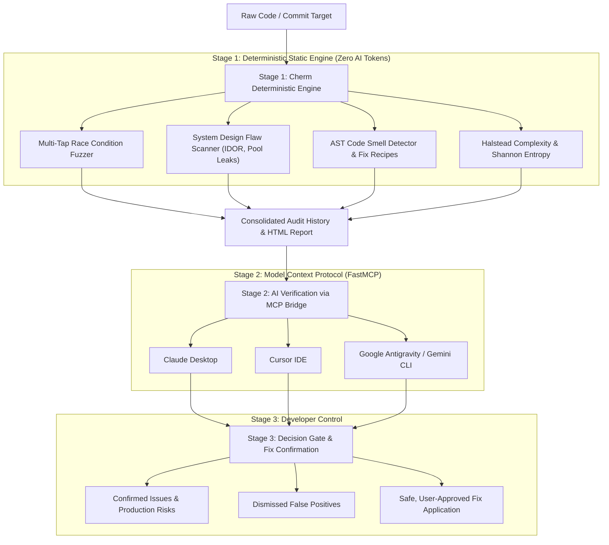

<div align="center">
  <div style="background-color: #0b0f19; padding: 24px 40px; border-radius: 12px; display: inline-block; margin-bottom: 12px; border: 1px solid #1e293b; box-shadow: 0 4px 20px rgba(0,255,128,0.15);">
    <span style="color: #38bdf8; font-family: monospace; font-size: 26px; font-weight: 900; letter-spacing: 4px; text-shadow: 0 0 10px rgba(56, 189, 248, 0.7);">( | - | [ - | ~ | \ / | ;</span>
  </div>
  <h1>Cherm</h1>
  <p><b>Interactive Terminal Companion • Model Context Protocol (MCP) Server • Localhost Web GUI</b></p>

  <p>
    
    
    
    
    
    
    
  </p>
</div>

---

> **A high-speed, local code analysis & system design inspection suite built for developers and AI agents alike — catching architectural flaws, race conditions, IDOR, and code smells before code is ever committed.**

Cherm operates in three seamless modalities:
1. **Interactive TUI**: Classic curses-based terminal companion with reactive ASCII avatar, AST fuzzer, and security suite.
2. **MCP Server**: Zero-token FastMCP bridge enabling Claude Desktop, Cursor, Antigravity, and Gemini to execute deep deterministic audits on your code.
3. **Localhost Web GUI**: Clean, distraction-free drag & drop code auditor running on **`http://localhost:3690`** for instant file inspection and findings.

---

## 📸 Snapshots & UI Tour

### 1. Interactive Terminal Companion (TUI)
*Runs fully offline inside your terminal with zero IDE lag, instant keyboard navigation, and shadow copy safety.*

```text
┌──────────────────────────────────────────────────────────────────────────────┐
│  (•‿•)   Cherm Terminal Companion                 [Status: Optimal]          │
├──────────────────────────────────────────────────────────────────────────────┤
│  TERMINAL CLOCK --                                                 __21:30:15│
│  [P]  order_controller.py                             (src/api/v1)           │
├──────────────────────────────────────────────────────────────────────────────┤
│                                                                              │
│                         Language / Execution Tools   >                       │
│                         General File Tools           >                       │
│                         Advanced Analysis & Security >                       │
│                   [*]   Cherm MCP Bridge (AI Server)                         │
│                   [*]   Launch Web GUI (localhost:3690)                      │
│                   ────────────────────────────────────────────               │
│                         Select Different File                                │
│                         Help  (?)                                            │
│                         Exit                                                 │
│                                                                              │
├──────────────────────────────────────────────────────────────────────────────┤
│  Up/Down:Nav  Enter:Run  B:Bookmark  ?:Help  Q:Back  ESC:Exit                │
└──────────────────────────────────────────────────────────────────────────────┘
```

---

### 2. Localhost Web GUI (`http://localhost:3690`)
*Minimalist, zero-slop drag-and-drop code auditor running locally in your browser with `python cherm.py --gui`.*

```text
┌──────────────────────────────────────────────────────────────────────────────┐
│  Cherm — Code Auditor                                        localhost:3690  │
├──────────────────────────────────────────────────────────────────────────────┤
│                                                                              │
│       ┌ ─ ─ ─ ─ ─ ─ ─ ─ ─ ─ ─ ─ ─ ─ ─ ─ ─ ─ ─ ─ ─ ─ ─ ─ ─ ─ ─ ─ ─ ─ ─ ─ ┐     │
│                         [ ↑ Drag & Drop Code File ]                          │
│                                                                              │
│                   Drag and drop your code file here to audit                 │
│              or click to browse (.py, .js, .ts, .go, .sql, etc.)             │
│       └ ─ ─ ─ ─ ─ ─ ─ ─ ─ ─ ─ ─ ─ ─ ─ ─ ─ ─ ─ ─ ─ ─ ─ ─ ─ ─ ─ ─ ─ ─ ─ ─ ┘     │
│                                                                              │
├──────────────────────────────────────────────────────────────────────────────┤
│  ARCHITECTURE GRADE: [ GRADE A ]   Status: PASS (Clean)                      │
│  • Total Issues: 0       • Race Conditions: 0       • ML Defect Risk: 4.2%   │
│  • Fatal Flaws:  0       • Design Flaws:    0       • Code Smells:    0      │
│                                                                              │
│  [ OK ] Clean code — no architectural bottlenecks or vulnerabilities found.  │
└──────────────────────────────────────────────────────────────────────────────┘
```

---

## 🧠 The 3-Stage Hybrid Review Pipeline

Cherm combines deterministic static rules with external AI agent verification through the **Model Context Protocol (MCP)**:



---

## ⚡ Quick Start & CLI Usage

### Launch Interactive Terminal TUI
```bash
# Open interactive file picker
python cherm.py

# Or launch targeted directly at a file
python cherm.py src/auth.py
```
> *Note: The distracting mini-game has been cleanly removed to ensure fast, continuous, uninterrupted testing.*

---

### Launch Localhost Web GUI
Launch the browser dashboard on port **`3690`** (`http://localhost:3690`):
```bash
# Starts server and automatically opens your default browser
python cherm.py --gui

# Or run directly on a custom port
python cherm.py --gui --port 8080
```
*Or select `[*] Launch Web GUI (localhost:3690)` directly from the TUI main menu!*

---

### Launch Model Context Protocol (MCP) Server
Enable AI assistants (Claude, Cursor, Antigravity) to query Cherm's static analyzer:
```bash
# Standard stdio mode (for Claude Desktop, Cursor, Antigravity)
python cherm.py --mcp

# Or SSE mode for remote/web access
python cherm.py --mcp --sse --port 8000
```

---

## 🤖 MCP AI Agent Configuration

Add Cherm to your AI assistant's configuration file:

### Claude Desktop (`claude_desktop_config.json`) / Cursor (`.cursor/mcp.json`):
```json
{
  "mcpServers": {
    "cherm": {
      "command": "python",
      "args": ["<path-to-cherm>/cherm.py", "--mcp"]
    }
  }
}
```

### Google Antigravity / Gemini CLI (`mcp_config.json`):
```json
{
  "mcpServers": {
    "cherm": {
      "command": "python",
      "args": ["C:/Antigravity program/checkinterminal/cherm.py", "--mcp"]
    }
  }
}
```

---

## 🛠️ The 7 Cherm MCP Tools

| Tool Name | Scope & Detection Capabilities |
| :--- | :--- |
| **`run_all_in_one_check`** | Full audit pipeline: system design flaws, race conditions, AST code smells, ML defect risk score, and standalone HTML report. |
| **`audit_system_design_flaws`** | Architectural vulnerabilities: BOLA/IDOR object exposure, database connection pool exhaustion, missing transaction rollbacks, CORS wildcards, and unhandled network timeouts. |
| **`explain_code_issues`** | AST anti-patterns: mutable default arguments (state leakage), bare `except:` clauses swallowing SIGTERM, and silent error suppression (`except: pass`) with exact fix recipes. |
| **`stress_test_multitap_vulnerability`** | Concurrency simulation: checks for Check-Then-Act (TOCTOU) race conditions, double-spend vulnerabilities, and missing row-level locking (`SELECT ... FOR UPDATE`). |
| **`audit_sha256_cryptographic_integrity`** | Cryptographic checks: weak hashing algorithms (MD5/SHA1), ECB block cipher modes, hardcoded IVs/salts, and timing side-channel leaks. |
| **`audit_ml_defects`** | Machine learning metrics: Halstead software complexity, AST structural anomaly detection via Isolation Forest, and Shannon Entropy secret scanning. |
| **`generate_html_audit_report`** | Generates a clean, professional, visual HTML report saved at `cherm_audit_report.html`. |

---

## 🛡️ Core Analysis Features

### Security & Penetration Testing
* **Full Pentest Suite:** Orchestrates `bandit` (Python deep scan), `semgrep` (multi-language security rules), and `safety` (dependency CVE check).
* **OWASP Vulnerability Audit:** Zero-dependency static pattern audit for SQL Injection, Command Injection, XSS, Path Traversal, and SSRF.
* **Shannon Entropy Secrets Detector:** Identifies high-entropy tokens, passwords, and API keys (AWS, GitHub PAT, Stripe, JWT) across source files.

### Node.js & Next.js Full-Stack Architecture Analysis
* **Event Loop Starvation Detection:** Automatically flags synchronous blocking operations (`fs.readFileSync`, `fs.writeFileSync`, `execSync`) on Node.js / Express / Next.js server threads.
* **Next.js `NEXT_PUBLIC_` Leaks:** Intercepts accidental leakage of backend secrets (database credentials, API keys, private tokens) exposed to client browsers via `NEXT_PUBLIC_` variable names.
* **Server Action & Route Guard Auditing:** Analyzes Next.js 14/15 App Router Server Actions (`'use server'`) for missing authentication, authorization, or rate-limiting guards.
* **Client / Server Boundary Validation:** Verifies `'use client'` directive presence on components utilizing React hooks (`useState`, `useEffect`, `useContext`) to avoid build failures and SSR hydration bugs.
* **Command Injection & Directory Traversal:** Discovers unescaped dynamic string interpolation in `child_process.exec` and boundary-breaking `path.join` / `path.resolve` parameters.
* **React XSS Prevention:** Flags unsanitized HTML injections via `dangerouslySetInnerHTML`.
* **Integrated Next.js Tooling:** Built-in TUI commands for `npx next lint`, `npx next build`, `npx tsc --noEmit`, and `npm audit`.

### Code Quality & AST Analysis
* **CrossCheckV200 Engine:** Automated function-level fuzz testing with dynamic mock injection to catch unexpected edge-case crashes.
* **Speed & Complexity Calculator:** Evaluates cyclomatic complexity, maximum nesting depth, and estimated Big-O Time & Space complexity.
* **Dead Code & Magic Number Scanner:** Flags unused variables, unreachable branches, and bare numeric literals that belong in named constants (supporting Python, JS, JSX, TS, TSX).
* **Shadow Copy Safety:** Original files are never modified or locked. All analysis runs inside an isolated shadow directory (`%TEMP%/cherm_shadow`).

---

## 🌐 Supported Languages & Ecosystems

Cherm provides native syntax validation, structure mapping, AST inspection, and security checks across:
* **Python**: Python 3.8+ (`.py`, `.pyw`) with AST parsing, Bandit, Semgrep, and Dead Code detection.
* **Node.js**: Modern JavaScript (`.js`, `.mjs`, `.cjs`) with event loop profiling, sync I/O alerts, and command injection scanning.
* **TypeScript & React**: Modern TS/TSX (`.ts`, `.tsx`, `.jsx`) with `tsc --noEmit` and component structure inspection.
* **Next.js**: App Router & Pages Router (`next.config.*`, Server Actions, SSR/SSG boundary checks, `npx next lint/build`).
* **Polyglot Systems**: Go, Rust, Java, C, C++, SQL, Ruby, PHP, Kotlin, Swift, Shell/Bash, PowerShell, HTML, CSS, JSON, YAML.

---

## 📦 Requirements & Installation

```bash
# Clone the repository
git clone https://github.com/subhajit-io/Cherm.git
cd Cherm/check-in-terminal

# Install dependencies for MCP and ML engines
pip install -r requirements_mcp.txt
```

*Requirements include:* `fastmcp>=2.0.0`, `uvicorn>=0.30.0`, `pydantic>=2.0.0`, `scikit-learn>=1.4.0`, `numpy>=1.26.0`.

---

## ⌨️ Global Keyboard Shortcuts (TUI)

| Key | Action |
| :---: | :--- |
| `Up` / `Down` | Navigate menu items and file lists |
| `Enter` | Select file or run highlighted action |
| `B` | Toggle bookmark on active file |
| `H` | Open generated HTML audit report in browser |
| `?` | Open interactive Help Panel |
| `Q` | Back to previous menu or return from results |
| `ESC` | Exit Cherm / Return to file selection |

---

## 📄 License

Distributed under the **MIT License**. See `LICENSE` for details.
Built with ❤️ by [Subhajit Das](https://github.com/subhajit-io).
