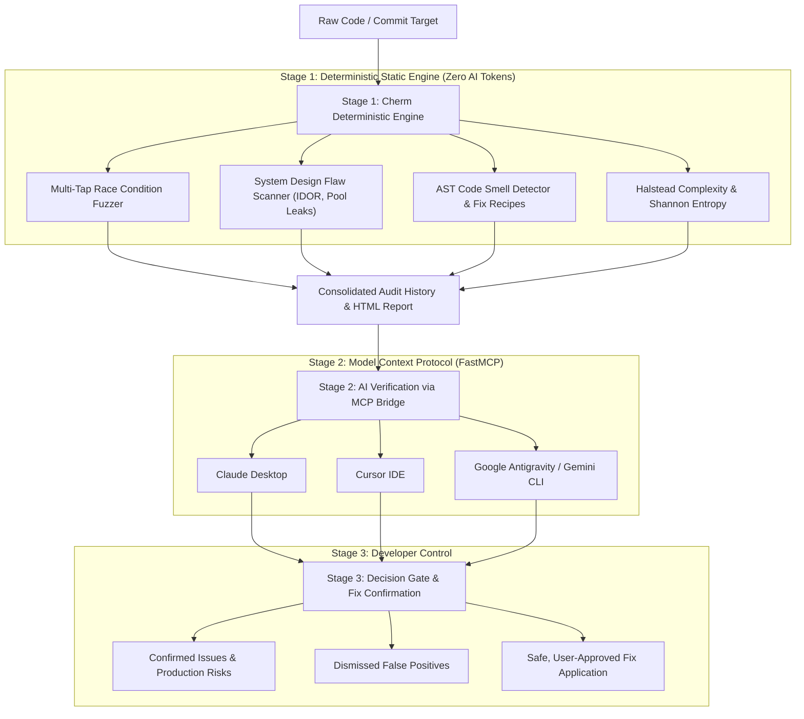

<div align="center">
  <div style="background-color: #0b0f19; padding: 24px 40px; border-radius: 12px; display: inline-block; margin-bottom: 12px; border: 1px solid #1e293b; box-shadow: 0 4px 20px rgba(0,255,128,0.15);">
    <span style="color: #38bdf8; font-family: monospace; font-size: 26px; font-weight: 900; letter-spacing: 4px; text-shadow: 0 0 10px rgba(56, 189, 248, 0.7);">( | - | [ - | ~ | \ / | ;</span>
  </div>
  <h1>Cherm</h1>
  <p><b>Interactive Terminal Companion • Model Context Protocol (MCP) Server • Localhost Web GUI</b></p>

  <p>
    
    
    
    
    
    
    
  </p>
</div>

---

> **A high-speed, local code analysis & system design inspection suite built for developers and AI agents alike — catching architectural flaws, race conditions, IDOR, and code smells before code is ever committed.**

Cherm operates across three flexible modalities:
1. **GUI (Terminal Companion)**: Classic curses-based terminal companion (`cherm gui`) with reactive ASCII avatar, AST fuzzer, and security suite.
2. **Web (Localhost Dashboard)**: Clean, distraction-free browser dashboard (`cherm web`) running on **`http://localhost:3690`** for visual drag & drop code & folder audits.
3. **Commands (Structured CLI Engine)**: Dedicated native CLI commands for CI/CD and terminal workflows:
   * **`check`**: Fast deterministic syntax, OWASP vulnerability, secrets, and dead code checks.
   * **`audit`**: Deep architecture, concurrency TOCTOU, and IDOR analysis with optional HTML report generation.
   * **`mcp`**: Zero-token FastMCP bridge for Claude Desktop, Cursor, Antigravity, and Gemini.
   * **`ext`**: Isolated extension engine for running and registering custom CLI tools and external scripts.

---

## Snapshots & UI Tour

### 1. Interactive Terminal Companion (TUI)
*Runs fully offline inside your terminal with zero IDE lag, instant keyboard navigation, and shadow copy safety.*

```text
┌──────────────────────────────────────────────────────────────────────────────┐
│  (•‿•)   Cherm Terminal Companion                 [Status: Optimal]          │
├──────────────────────────────────────────────────────────────────────────────┤
│  TERMINAL CLOCK --                                                 __21:30:15│
│  [P]  order_controller.py                             (src/api/v1)           │
├──────────────────────────────────────────────────────────────────────────────┤
│                                                                              │
│                         Language / Execution Tools   >                       │
│                         General File Tools           >                       │
│                         Advanced Analysis & Security >                       │
│                   [*]   Cherm MCP Bridge (AI Server)                         │
│                   ────────────────────────────────────────────               │
│                         Select Different File                                │
│                         Help & User Manual  (?)                              │
│                         Exit                                                 │
│                                                                              │
├──────────────────────────────────────────────────────────────────────────────┤
│  Up/Down:Nav  Enter:Run  B:Bookmark  ?:Help  Q:Back  ESC:Exit                │
└──────────────────────────────────────────────────────────────────────────────┘
```

---

### 2. Localhost Web GUI (`http://localhost:3690`)
*Minimalist, zero-slop drag-and-drop code & project auditor running locally in your browser with `cherm --gui`. Supports single files or entire repository folders.*

```text
┌──────────────────────────────────────────────────────────────────────────────┐
│  Cherm — Code & Project Auditor                              localhost:3690  │
├──────────────────────────────────────────────────────────────────────────────┤
│  [ Drag & Drop (File or Folder) ]   [ Local Directory Scan ]   [ Snippet ]   │
├──────────────────────────────────────────────────────────────────────────────┤
│                                                                              │
│       ┌ ─ ─ ─ ─ ─ ─ ─ ─ ─ ─ ─ ─ ─ ─ ─ ─ ─ ─ ─ ─ ─ ─ ─ ─ ─ ─ ─ ─ ─ ─ ─ ─ ┐     │
│                     [ Drag & Drop File OR Full Folder ]                   │
│                                                                              │
│             Drop any single file or drag an entire project folder            │
│            [ Browse Single File ]     [ Browse Full Folder ]           │
│       └ ─ ─ ─ ─ ─ ─ ─ ─ ─ ─ ─ ─ ─ ─ ─ ─ ─ ─ ─ ─ ─ ─ ─ ─ ─ ─ ─ ─ ─ ─ ─ ─ ┘     │
│                                                                              │
├──────────────────────────────────────────────────────────────────────────────┤
│  PROJECT: my-next-app (16 code files • 2,410 lines • 120 KB)              │
│  [ Run Full Project Audit (16 files) ]                                     │
├──────────────────────────────────────────────────────────────────────────────┤
│  PROJECT GRADE: [ GRADE A ]   Status: 16/16 Files Clean • PASS               │
│  • Files Audited: 16     • Vulnerable Files: 0     • Total Issues: 0         │
│  • Fatal Flaws:   0      • Concurrency Flaws: 0    • Design Flaws: 0         │
│                                                                              │
│  FILE BREAKDOWN:                                                             │
│  [PASS]     src/app/checkout/page.tsx                     (140 lines • Clean)│
│  [PASS]     src/lib/auth.ts                               (88 lines • Clean) │
│  [PASS]     src/components/Header.tsx                     (62 lines • Clean) │
└──────────────────────────────────────────────────────────────────────────────┘
```

---

## The 3-Stage Hybrid Review Pipeline

Cherm combines deterministic static rules with external AI agent verification through the **Model Context Protocol (MCP)**:



---

## Three Primary Modalities & Quick Start

### 1. GUI Mode (Terminal Companion)
Launch the interactive full-terminal companion:
```bash
# Open interactive file picker
cherm gui

# Or launch directly targeted at a file
cherm gui src/auth.py
```
*(For complete keyboard shortcuts, screen walkthroughs, and in-app menu breakdowns, see the [Terminal Companion (TUI) User Manual](#-terminal-companion-tui-user-manual--in-app-commands) below.)*

---

### 2. Web Mode (Localhost Browser Dashboard)
Launch the browser dashboard on port **`3690`** (`http://localhost:3690`):
```bash
# Starts server and automatically opens your default browser
cherm web

# Or specify a custom port
cherm web --port 8080
```

---

### 3. Commands Mode (CLI Engine)

Cherm provides cleanly namespaced commands for deterministic checks, system design audits, and external software extensions:

#### A. Deterministic Code Checks (`check`)
Fast static checks without IDE overhead or curses UI:
```bash
# Run all checks (syntax, security, secrets, dead code) on a file or folder
cherm check src/auth.py
cherm check ./src

# Target specific checks
cherm check src/auth.py --syntax      # Syntax compilation check only
cherm check src/auth.py --security    # OWASP pattern scanner only
cherm check src/auth.py --secrets     # Shannon entropy secrets scan only
cherm check src/auth.py --deadcode    # Python AST dead code detector only

# Output machine-readable JSON for CI/CD
cherm check src/auth.py --json
```

#### B. Deep Architecture & System Design Audit (`audit`)
Deep multi-file analysis testing for TOCTOU race hazards, IDOR/BOLA object leaks, and connection pool exhaustion:
```bash
# Audit an entire repository folder or single file
cherm audit ./src

# Generate standalone visual HTML report (cherm_audit_report.html)
cherm audit ./src --report

# Output structured JSON
cherm audit ./src --json
```

#### C. Model Context Protocol Bridge (`mcp`)
Start Cherm as an MCP server for AI assistants:
```bash
# Standard stdio mode (for Claude Desktop, Cursor, Antigravity)
cherm mcp

# SSE mode for web/network integration
cherm mcp --sse --port 8000
```

#### D. Connected Software & Extension Engine (`ext`)
Isolated container for registering and executing custom CLI tools and external scripts:
```bash
# List all registered external commands
cherm ext list

# Execute a connected command
cherm ext run file_details_cli src/main.py

# Register a new external CLI tool
cherm ext add my_linter "Custom Linter" "eslint {file}" ".js,.ts" "Linters"

# Direct alias execution (runs any registered command ID directly)
cherm my_linter src/main.py
```

#### E. Dedicated Feature CLI Commands
Every individual inspection feature in Cherm is available as a standalone first-class terminal command:

| Category | Command | Target | Description |
| :--- | :--- | :--- | :--- |
| **Quality** | `cherm syntax <file>` | File or dir | Validate syntax & compilation without execution |
| **Quality** | `cherm complexity <file>` | File or dir | Calculate Big-O time & space, cyclomatic complexity & nesting |
| **Quality** | `cherm deadcode <file>` | File or dir | AST detection of uncalled functions & unused variables |
| **Quality** | `cherm magic <file>` | File or dir | Scan for bare numeric literals / unexplained magic numbers |
| **Quality** | `cherm stats <file>` | File or dir | Line count, code vs comments vs blank ratio, size, words |
| **Quality** | `cherm scan <file>` | File or dir | Extract & index all defined functions, classes, exports & types |
| **Quality** | `cherm cp <file>` | File | Competitive Programming (CP) test runner & stdin/stdout validator |
| **Quality** | `cherm fuzz <file>` | File | CrossCheckV200 dynamic mock injection & input boundary fuzzer |
| **Security** | `cherm sec <target>` | File or dir | OWASP static vulnerability detector (SQLi, XSS, Command Injection) |
| **Security** | `cherm secrets <target>` | File or dir | Shannon entropy & pattern scanner for API keys, passwords & tokens |
| **Security** | `cherm pentest <target>` | File or dir | Security orchestration with Bandit, Semgrep, and Safety |
| **Security** | `cherm crypto <file>` | File | SHA-256 integrity check, timing attacks, unsalted password hashes |
| **Architecture** | `cherm design <target>` | File or dir | Audit for BOLA/IDOR, pool exhaustion, missing rollback, CORS |
| **Architecture** | `cherm race <file>` | File | Concurrency multi-tap & TOCTOU double-spend hazard detector |
| **Architecture** | `cherm ml <file>` | File | Machine learning AST structural anomaly scoring & Halstead metrics |
| **Architecture** | `cherm check <target>` | File or dir | Deterministic all-in-one check (syntax, security, secrets, deadcode) |
| **Architecture** | `cherm audit <target>` | File or dir | Deep architectural & concurrency audit with optional `--report` |
| **Utilities** | `cherm urls <target>` | File or dir | Discover HTTP/API endpoints and verify responsiveness |
| **Utilities** | `cherm diff <f1> [f2]` | Files | Unified terminal diff viewer against Git HEAD or baseline file |
| **Utilities** | `cherm git [args]` | Workspace | Terminal Git command center |
| **Utilities** | `cherm report <target>` | File or dir | Generate visual standalone HTML audit report dashboard (`--open`) |

---

### Complete Command Reference Manual

#### 1. Code Quality & Complexity Commands

##### `syntax` — Syntax & Bytecode Compilation Check
Validates code syntax and parses AST without executing untrusted code.
* **Usage:** `cherm syntax <file|dir> [--json]`
* **Supported files:** Python (`.py`), JSON (`.json`), JavaScript, TypeScript, Go, SQL.
* **Example:**
  ```bash
  cherm syntax src/server.py
  cherm syntax ./src --json
  ```

##### `complexity` — Algorithmic Time, Space & Cyclomatic Complexity
Estimates Big-O time and space complexity, cyclomatic branching score, and maximum loop/nesting depth.
* **Usage:** `cherm complexity <file|dir> [--json]`
* **Metrics:** Big-O Time (`O(1)`, `O(N)`, `O(N²)`, `O(N^k)`), Space complexity, Cyclomatic Score, Verdict (`Clean`, `Moderate`, `High Complexity`).
* **Example:**
  ```bash
  cherm complexity src/algorithms.py
  ```

##### `deadcode` — Unused Function & Dead Branch Detector
Uses AST inspection to discover functions and variables that are defined but never invoked across the module.
* **Usage:** `cherm deadcode <file|dir> [--json]`
* **Example:**
  ```bash
  cherm deadcode src/utils.py
  ```

##### `magic` — Magic Numbers Scanner
Detects bare, unexplained numeric literals in expressions that should be extracted into named constants for maintainability.
* **Usage:** `cherm magic <file|dir> [--json]`
* **Example:**
  ```bash
  cherm magic src/pricing_engine.py
  ```

##### `stats` — Source Code Metrics & Ratios
Reports total lines, physical lines of code (SLOC), blank lines, comment ratio (%), byte size, and vocabulary size.
* **Usage:** `cherm stats <file|dir> [--json]`
* **Example:**
  ```bash
  cherm stats src/main.py
  ```

##### `scan` — Declaration & Symbol Indexer
Scans code and extracts all function signatures, classes, types, interfaces, and module exports.
* **Usage:** `cherm scan <file|dir> [--json]`
* **Example:**
  ```bash
  cherm scan src/models.py
  ```

##### `cp` — Competitive Programming (CP) Automated Test Runner
Executes solutions against paired input and expected output test cases (`in1.txt` → `out1.txt`, `in2.txt` → `out2.txt`) across Python, Node.js, C, C++, and compiled executables.
* **Usage:** `cherm cp <file> [--json]`
* **Test Directory:** Looks for `tests/<file_base>/in*.txt` and `out*.txt` (or directory containing `in1.txt` / `out1.txt`). Automatically initializes a template test suite if none exists.
* **Checks:** Exact stdout output matching, runtime duration, and 5.0s Time Limit Exceeded (TLE) protection.
* **Example:**
  ```bash
  cherm cp solution.cpp
  cherm cp solution.py
  ```

##### `fuzz` — CrossCheckV200 Dynamic Mock Injection & Edge-Case Fuzzer
Simulates massive edge-case inputs (nulls, empty strings, negative numbers, floating points, integer overflows, boundary arrays) on functions to verify input contracts and prevent unexpected runtime crashes.
* **Usage:** `cherm fuzz <file> [--json]`
* **Example:**
  ```bash
  cherm fuzz src/parser.py
  ```

---

#### 2. Security & Penetration Testing Commands

##### `sec` — OWASP Static Vulnerability Scanner
Scans source files for top OWASP vulnerability patterns without requiring cloud or network connectivity.
* **Vulnerabilities checked:** SQL Injection (f-strings, concatenation), Command Injection (`os.system`, `subprocess(shell=True)`), Code Injection (`eval`, `exec`), Path Traversal, XSS (`innerHTML`, `dangerouslySetInnerHTML`), SSRF (`urlopen`, `requests.get`), Insecure Deserialization (`pickle.loads`, `yaml.load`), Weak Cryptography (MD5, SHA1), and CORS wildcards (`*`).
* **Usage:** `cherm sec <file|dir> [--json]`
* **Example:**
  ```bash
  cherm sec src/api/endpoints.py
  cherm sec ./src --json
  ```

##### `secrets` — Shannon Entropy & Hardcoded Credential Detector
Scans code using high-entropy mathematics and regular expression signatures to find exposed secrets before they reach git.
* **Secrets detected:** AWS Access Key IDs, GitHub Personal Access Tokens (PAT), JWT tokens, Stripe secret keys, hardcoded passwords, Bearer tokens, and Private Key blocks (`BEGIN PRIVATE KEY`).
* **Usage:** `cherm secrets <file|dir> [--json]`
* **Example:**
  ```bash
  cherm secrets src/config.py
  ```

##### `pentest` — Automated Security Tool Orchestration
Orchestrates static analysis and security linters (Bandit for Python, Semgrep for polyglot rules, Safety for vulnerable packages).
* **Usage:** `cherm pentest <file|dir> [--json]`
* **Example:**
  ```bash
  cherm pentest ./src
  ```

##### `crypto` — SHA-256 Cryptographic Integrity & Cipher Audit
Calculates deterministic SHA-256 checksums, verifies tamper baselines, and inspects code for cryptographic anti-patterns.
* **Checks:** Non-constant-time comparisons (Timing Attacks), raw unsalted SHA-256 password hashing, weak hashing algorithms, and ECB block cipher modes.
* **Usage:** `cherm crypto <file> [--json]`
* **Example:**
  ```bash
  cherm crypto src/auth.py
  ```

---

#### 3. Architecture & System Design Commands

##### `design` — System Design & Scaling Flaw Auditor
Scans for architectural vulnerabilities that bypass unit tests but crash production servers or leak data.
* **Flaws audited:** Broken Object Level Authorization (BOLA/IDOR), database connection pool exhaustion (missing pool close/release), unhandled transaction rollbacks, CORS wildcard permissions, and unbounded query pagination.
* **Usage:** `cherm design <file|dir> [--json]`
* **Example:**
  ```bash
  cherm design src/controllers/order.py
  ```

##### `race` — Multi-Tap & TOCTOU Race Condition Simulator
Simulates rapid parallel requests (50 simultaneous taps in 1.0s) against critical financial and state-mutation endpoints to detect Check-Then-Act (TOCTOU) race conditions and double-spending vulnerabilities.
* **Checks:** Missing frontend button debounce/disabling, missing backend `Idempotency-Key` headers, and missing database row-level locking (`SELECT ... FOR UPDATE`).
* **Usage:** `cherm race <file> [--json]`
* **Example:**
  ```bash
  cherm race src/payment_processor.py
  ```

##### `ml` — Machine Learning AST Structural Anomaly & Defect Risk
Applies local machine learning algorithms (Isolation Forest for structural AST anomaly detection, Halstead software science metrics, and Shannon entropy) to calculate an aggregate defect propensity score (0-100).
* **Usage:** `cherm ml <file> [--json]`
* **Example:**
  ```bash
  cherm ml src/core.py
  ```

##### `check` — All-In-One Deterministic Code Checker
Fast, lightweight check covering syntax, OWASP vulnerabilities, secrets, and dead code in a single command.
* **Usage:** `cherm check <file|dir> [--syntax] [--security] [--secrets] [--deadcode] [--json]`
* **Example:**
  ```bash
  cherm check src/auth.py
  cherm check ./src --syntax --security
  ```

##### `audit` — Deep Full-System Architectural Audit
Full-scale architectural audit producing overall project Health Grades (Grade A to F), categorized issue counts, and optional standalone visual HTML report generation.
* **Usage:** `cherm audit <file|dir> [--report] [--json]`
* **Example:**
  ```bash
  cherm audit ./src
  cherm audit ./src --report    # Generates cherm_audit_report.html
  ```

---

#### 4. Utilities & Diagnostics

##### `urls` — API Endpoints & URL Connectivity Checker
Discovers all HTTP and HTTPS endpoints declared in source files and sends concurrent lightweight HEAD/GET probes to verify server responsiveness.
* **Usage:** `cherm urls <file|dir> [--json]`
* **Example:**
  ```bash
  cherm urls src/services/api_client.py
  ```

##### `diff` — Terminal Side-by-Side Unified Diff Viewer
Provides formatted unified diff output against Git HEAD or compares two arbitrary files directly in the terminal.
* **Usage:**
  - Compare file against git HEAD: `cherm diff <file>`
  - Compare two files: `cherm diff <file1> <file2>`
  - Git working tree diff: `cherm diff`
* **Example:**
  ```bash
  cherm diff src/auth.py
  cherm diff version1.py version2.py
  ```

##### `git` — Interactive Git Command Center
Runs arbitrary Git operations directly through Cherm's unified CLI runner.
* **Usage:** `cherm git [status|diff|log|branch|...]`
* **Example:**
  ```bash
  cherm git status -s
  cherm git log -n 5 --oneline
  ```

##### `report` — Visual Standalone HTML Dashboard Generator
Compiles an interactive, standalone HTML audit report (`cherm_audit_report.html`) complete with metrics, flaw breakdowns, and fix recommendations.
* **Usage:** `cherm report <file|dir> [--open]`
* **Example:**
  ```bash
  cherm report ./src --open     # Generates report and opens default browser
  ```

---

#### 5. Connected Software & Extension Engine (`ext`)

Cherm enables developers to integrate external tools, custom scripts, and third-party linters cleanly via `cherm_commands.json`:

##### `ext list` — List Connected Software Commands
Displays all registered tools, their command templates, target file extensions, and categories.
* **Usage:** `cherm ext list [--json]`

##### `ext add` — Register an External Tool
Adds or updates a custom tool command definition in the configuration registry.
* **Usage:** `cherm ext add <id> <name> <cmd_template> [extensions] [category]`
* **Example:**
  ```bash
  cherm ext add py_black "Black Formatter" "black {file}" ".py" "Formatters"
  cherm ext add es_lint "ESLint" "npx eslint {file}" ".js,.ts,.tsx" "Linters"
  ```

##### `ext remove` — Unregister an External Tool
Removes a command ID from the configuration registry.
* **Usage:** `cherm ext remove <id>`
* **Example:**
  ```bash
  cherm ext remove py_black
  ```

##### `ext run` — Execute an External Command
Runs a connected command using Cherm's secure execution runner with variable interpolation.
* **Usage:** `cherm ext run <id> [file] [extra_args...]`
* **Example:**
  ```bash
  cherm ext run py_black src/server.py
  ```

##### Direct Command Alias (Top-Level Execution)
Any registered command ID can also be run directly as a top-level command alias:
* **Example:**
  ```bash
  cherm py_black src/server.py
  cherm es_lint src/App.tsx --fix
  ```

#### Template Placeholders Supported in Commands:
* `{file}`: Full absolute path to target file
* `{filename}`: File name with extension (e.g. `auth.ts`)
* `{basename}`: File name without extension (e.g. `auth`)
* `{ext}`: Extension (e.g. `.ts`)
* `{dir}`: Directory containing the target file
* `{cwd}`: Current working directory / project root
* `{python}`: Current Python interpreter executable path
* `{args}`: Additional arguments passed to the command

*Configuration is stored in `cherm_commands.json` (or `.cherm/commands.json`) and editable directly or via TUI and Web GUI!*

---

## MCP AI Agent Configuration

Add Cherm to your AI assistant's configuration file:

### Claude Desktop (`claude_desktop_config.json`) / Cursor (`.cursor/mcp.json`):
```json
{
  "mcpServers": {
    "cherm": {
      "command": "python",
      "args": ["<path-to-cherm>/cherm.py", "--mcp"]
    }
  }
}
```

### Google Antigravity / Gemini CLI (`mcp_config.json`):
```json
{
  "mcpServers": {
    "cherm": {
      "command": "python",
      "args": ["C:/Antigravity program/checkinterminal/cherm.py", "--mcp"]
    }
  }
}
```

---

## The 11 Cherm MCP Tools

| Tool Name | Scope & Detection Capabilities |
| :--- | :--- |
| **`run_folder_audit`** | Full project & folder pipeline: scans entire directories or multi-file uploads (up to 500 files), calculating project health grade, per-file issue breakdown, and comprehensive HTML report. |
| **`run_all_in_one_check`** | Full audit pipeline: system design flaws, race conditions, AST code smells, ML defect risk score, and standalone HTML report. |
| **`audit_system_design_flaws`** | Architectural vulnerabilities: BOLA/IDOR object exposure, database connection pool exhaustion, missing transaction rollbacks, CORS wildcards, and unhandled network timeouts. |
| **`explain_code_issues`** | AST anti-patterns: mutable default arguments (state leakage), bare `except:` clauses swallowing SIGTERM, and silent error suppression (`except: pass`) with exact fix recipes. |
| **`stress_test_multitap_vulnerability`** | Concurrency simulation: checks for Check-Then-Act (TOCTOU) race conditions, double-spend vulnerabilities, and missing row-level locking (`SELECT ... FOR UPDATE`). |
| **`audit_sha256_cryptographic_integrity`** | Cryptographic checks: weak hashing algorithms (MD5/SHA1), ECB block cipher modes, hardcoded IVs/salts, and timing side-channel leaks. |
| **`audit_ml_defects`** | Machine learning metrics: Halstead software complexity, AST structural anomaly detection via Isolation Forest, and Shannon Entropy secret scanning. |
| **`generate_html_audit_report`** | Generates a clean, professional, visual HTML report saved at `cherm_audit_report.html`. |
| **`list_connected_software_commands`** | Lists all custom developer terminal commands and external software connected to Cherm via `cherm_commands.json`. |
| **`run_connected_software_command`** | Executes an external software CLI command or custom developer script, returning stdout, stderr, exit code, and runtime duration. |
| **`register_software_command`** | Programmatically registers a new external software terminal command into Cherm's command hub. |

---

## Core Analysis Features

### Security & Penetration Testing
* **Full Pentest Suite:** Orchestrates `bandit` (Python deep scan), `semgrep` (multi-language security rules), and `safety` (dependency CVE check).
* **OWASP Vulnerability Audit:** Zero-dependency static pattern audit for SQL Injection, Command Injection, XSS, Path Traversal, and SSRF.
* **Shannon Entropy Secrets Detector:** Identifies high-entropy tokens, passwords, and API keys (AWS, GitHub PAT, Stripe, JWT) across source files.

### Node.js & Next.js Full-Stack Architecture Analysis
* **Event Loop Starvation Detection:** Automatically flags synchronous blocking operations (`fs.readFileSync`, `fs.writeFileSync`, `execSync`) on Node.js / Express / Next.js server threads.
* **Next.js `NEXT_PUBLIC_` Leaks:** Intercepts accidental leakage of backend secrets (database credentials, API keys, private tokens) exposed to client browsers via `NEXT_PUBLIC_` variable names.
* **Server Action & Route Guard Auditing:** Analyzes Next.js 14/15 App Router Server Actions (`'use server'`) for missing authentication, authorization, or rate-limiting guards.
* **Client / Server Boundary Validation:** Verifies `'use client'` directive presence on components utilizing React hooks (`useState`, `useEffect`, `useContext`) to avoid build failures and SSR hydration bugs.
* **Command Injection & Directory Traversal:** Discovers unescaped dynamic string interpolation in `child_process.exec` and boundary-breaking `path.join` / `path.resolve` parameters.
* **React XSS Prevention:** Flags unsanitized HTML injections via `dangerouslySetInnerHTML`.
* **Integrated Next.js Tooling:** Built-in TUI commands for `npx next lint`, `npx next build`, `npx tsc --noEmit`, and `npm audit`.

### Code Quality, Competitive Programming & AST Analysis
* **Competitive Programming (CP) Test Runner:** Automated input/output validation engine (`cherm cp <file>`). Feeds paired stdin test cases (`in1.txt`, `in2.txt`) to problem solutions across languages (Python, C++, Java, Node.js) and verifies expected stdout (`out1.txt`, `out2.txt`) with execution timers and TLE protection.
* **CrossCheckV200 Fuzz Engine:** Automated function-level fuzz testing with dynamic mock injection to catch unexpected edge-case crashes.
* **Speed & Complexity Calculator:** Evaluates cyclomatic complexity, maximum nesting depth, and estimated Big-O Time & Space complexity.
* **Dead Code & Magic Number Scanner:** Flags unused variables, unreachable branches, and bare numeric literals that belong in named constants (supporting Python, JS, JSX, TS, TSX).
* **Shadow Copy Safety:** Original files are never modified or locked. All analysis runs inside an isolated shadow directory (`%TEMP%/cherm_shadow`).

---

## Supported Languages & Ecosystems

Cherm provides native syntax validation, structure mapping, AST inspection, and security checks across:
* **Python**: Python 3.8+ (`.py`, `.pyw`) with AST parsing, Bandit, Semgrep, and Dead Code detection.
* **Node.js**: Modern JavaScript (`.js`, `.mjs`, `.cjs`) with event loop profiling, sync I/O alerts, and command injection scanning.
* **TypeScript & React**: Modern TS/TSX (`.ts`, `.tsx`, `.jsx`) with `tsc --noEmit` and component structure inspection.
* **Next.js**: App Router & Pages Router (`next.config.*`, Server Actions, SSR/SSG boundary checks, `npx next lint/build`).
* **Polyglot Systems**: Go, Rust, Java, C, C++, SQL, Ruby, PHP, Kotlin, Swift, Shell/Bash, PowerShell, HTML, CSS, JSON, YAML.

---

## Download & Installation (Standalone Binaries & Installers)

Cherm is distributed as standalone native binaries for Windows, macOS, and Linux:

### 1. Precompiled Native Binaries
* **Windows (64-bit .exe)**:
  [Download Cherm.exe](https://cherm-documentation.vercel.app/downloads/Cherm.exe) — Native 64-bit standalone executable. Direct download, zero Python required.
* **macOS Binary**:
  [Download macOS Binary](https://cherm-documentation.vercel.app/downloads/cherm-macos) — Standalone single-file binary for Apple Silicon and Intel systems.
* **Linux Binary**:
  [Download Linux Binary](https://cherm-documentation.vercel.app/downloads/cherm-linux) — Self-contained single-file executable for Ubuntu, Debian, Fedora, Arch, CentOS.

### 2. Universal Automated Installers (One-Liner Install)

#### macOS & Linux (curl)
```bash
# Installs Cherm to ~/.local/bin/cherm and configures your PATH:
curl -fsSL https://raw.githubusercontent.com/subhajit-io/Cherm/main/install.sh | bash

# Test installation:
cherm --help
```

#### Windows (PowerShell)
```powershell
# Installs Cherm.exe and configures User PATH:
irm https://raw.githubusercontent.com/subhajit-io/Cherm/main/install.ps1 | iex

# Test installation:
cherm --help
```

#### Git Clone (Full Development Suite)
```bash
git clone https://github.com/subhajit-io/Cherm.git
cd Cherm/check-in-terminal
pip install -r requirements_mcp.txt
cherm
```

### 3. Language & Environment Tooling

Cherm operates fully offline with native AST inspection. When language tools are installed on your system, Cherm seamlessly integrates with them:

| Language / Tool | Installation Command | Cherm Feature Enabled |
| :--- | :--- | :--- |
| **Python MCP & ML** | `pip install -r requirements_mcp.txt` | FastMCP AI server, Isolation Forest ML anomaly scoring, Shannon entropy |
| **Node.js & TypeScript** | `npm install -g typescript eslint` | `tsc --noEmit` type checking, ESLint integration |
| **Python Pentest Suite** | `pip install bandit semgrep safety` | Automated security orchestration (`cherm pentest`) |
| **Go Toolchain** | `go install` | `go vet` and Go syntax verification |
| **Rust Toolchain** | `rustup` | `rustc` and `cargo check` compiler validation |

---

## Terminal Companion (TUI) User Manual & In-App Commands

Cherm's Terminal Companion (TUI) is an interactive, curses-based developer environment engineered to run offline in any terminal or remote SSH session with zero UI lag and shadow-copy safety.

### How to Launch the TUI
```bash
# 1. Open the interactive file browser (Default):
cherm

# 2. Open via the gui subcommand:
cherm gui

# 3. Launch directly targeted at a file:
cherm gui src/auth.py
```

---

### The Three TUI Screen Modes

1. **Screen 1: Interactive File Browser**
   - Browse project directories with arrow keys (`Up` / `Down` or `k` / `j`).
   - Displays file names, sizes, file types, and live header clock.
   - Press `/` to search/filter files in real time.
   - Press `Space` to tag multiple files for batch inspection.
   - Press `B` to star/unstar bookmarks for instant access.
   - Press `M` to jump directly to the Bookmarks view.
   - Press `Left` or `Backspace` to navigate up to the parent directory.

2. **Screen 2: Main Action & Feature Menu**
   - After selecting or tagging files, Cherm opens the main action menu organized into 4 categorized submenus:
     - **Language / Execution Tools**
     - **General File Tools**
     - **Advanced Analysis & Security**
     - **Connected Software Commands**
   - Also includes direct actions:
     - `[*] Cherm MCP Bridge (AI Server)` — Starts FastMCP bridge on stdio.
     - `Select Different File` — Return to file browser.
     - `Help & User Manual (?)` — Interactive scrollable user manual.
     - `Exit` — Gracefully exits Cherm.

3. **Screen 3: Results & Analysis Viewer**
   - Clean scrollable output with color-coded alerts (Green PASS, Yellow WARN, Red FAIL/CRITICAL).
   - Press `Up` / `Down` to scroll by line, `PgUp` / `PgDn` to scroll by page.
   - Press `g` / `Home` to jump to top, `G` / `End` to jump to bottom.
   - Press `H` after an audit to automatically open the generated visual HTML report in your browser.
   - Press `Q` or `ESC` to return to the menu.

---

### In-TUI Menu Commands Reference

#### Menu 1: Language / Execution Tools
* **`Check Syntax (<filename>)`**: Validates code syntax and parses bytecode (e.g. `py_compile`, `node --check`) without executing untrusted code.
* **`Execute File (<filename>)`**: Safely executes target file inside an isolated shadow copy in `%TEMP%/cherm_shadow`. Your repository files are never locked or modified.
* **`Speed & Complexity (<filename>)`**: Calculates estimated Big-O time complexity ($O(1)$, $O(N)$, $O(N^2)$, $O(N^k)$), cyclomatic complexity score, and maximum loop nesting depth in real time.
* **`Scan Functions & Exports (<filename>)`**: Extracts and indexes all declared functions, methods, classes, types, interfaces, and module exports.

#### Menu 2: General File Tools
* **`Auto-Detect & Test URLs`**: Discovers all HTTP and HTTPS endpoints declared in the file and sends lightweight network probes to verify server responsiveness.
* **`File Statistics`**: Displays comprehensive file metrics: total lines, physical lines of code (SLOC), blank lines, comment ratio (%), byte size, and vocabulary count.
* **`View Raw File`**: Opens a scrollable in-terminal file viewer with line numbering, horizontal scrolling, and line jump (`L` key).
* **`Search in File`**: Performs case-insensitive substring and regex searches within the active file, highlighting line numbers.
* **`Copy Path to Clipboard`**: Copies the absolute system path of the target file to your operating system clipboard.

#### Menu 3: Advanced Analysis & Security
* **`Git Command Center`**: Interactive terminal Git runner providing status (`-sb`), commit history (`git log`), branch listing, and diffs.
* **`Scan for Hardcoded Secrets`**: Shannon entropy and regex signature scanner detecting exposed API keys (AWS, Stripe, GitHub PAT), JWT tokens, and passwords.
* **`Detect Magic Numbers`**: Scans expressions for unexplained bare numeric literals that should be extracted into named constants.
* **`Dead Code Detector`**: AST tree inspection identifying functions, variables, and branches that are declared but never invoked across the module.
* **`Diff Viewer (git / file)`**: Color-coded unified diff viewer comparing the active file against Git HEAD or against another file.
* **`Security Vulnerability Scan`**: Zero-dependency OWASP static pattern audit checking for SQL Injection, Command Injection (`os.system`, `shell=True`), XSS, Path Traversal, and SSRF.
* **`Multi-File Batch Checker`**: Executes syntax, secret, and dead code audits simultaneously across all files tagged with `Space` in the file browser.
* **`FULL PENTEST (Hackproof?)`**: Orchestrates automated penetration testing tools (Bandit for Python AST, Semgrep for polyglot rules, and Safety for vulnerable packages).
* **`Cherm MCP: Deep AI Audit`**: Full architectural inspection evaluating system design flaws, multi-tap race conditions, and compiling a standalone HTML report.

#### Menu 4: Connected Software Commands
* **`[Custom Commands]`**: Executes external scripts, custom linters, and developer tools connected via `cherm_commands.json` matching the active file's extension.
* **`+ Connect New Terminal Command`**: Interactive wizard to register a new external terminal command with template variable placeholders (`{file}`, `{dir}`, `{args}`).
* **`[?] View Connected Software & Config`**: Displays all registered external software commands, their categories, and active configuration file path.
* **`[R] Reload Connected Commands`**: Hot-reloads `cherm_commands.json` from disk without restarting Cherm.

---

### Master Keyboard Controls & Shortcuts Cheat Sheet

| Key | Context | Action |
| :---: | :--- | :--- |
| `Up` / `Down` (or `k` / `j`) | All screens | Move cursor / selection up or down |
| `Enter` | File Browser | Open selected file or enter directory |
| `Enter` | Main Menu | Execute highlighted action command |
| `Left` / `Backspace` | File Browser | Navigate up to parent directory |
| `Q` / `q` | Menus & Results | Close results viewer or return to previous menu |
| `ESC` | All screens | Cancel current action, exit viewer, or exit Cherm |
| `?` | Global | Open the in-TUI Help Panel & User Manual |
| `B` | File Browser & Menu | Toggle star bookmark on active file |
| `M` | File Browser | Jump to Bookmarks menu |
| `SPACE` | File Browser | Tag / untag file for multi-file batch checking |
| `/` | File Browser | Search / filter files in active directory |
| `H` | After Audit | Open generated visual HTML audit report in default browser |
| `PgUp` / `PgDn` | Results & Viewer | Scroll output one full page |
| `g` / `Home` | Results & Viewer | Jump to top of output |
| `G` / `End` | Results & Viewer | Jump to bottom of output |
| `L` / `l` | Raw File Viewer | Jump directly to a specific line number |

---

## License

Distributed under the **MIT License**. See `LICENSE` for details.
Built with dedication by [Subhajit Das](https://github.com/subhajit-io).
